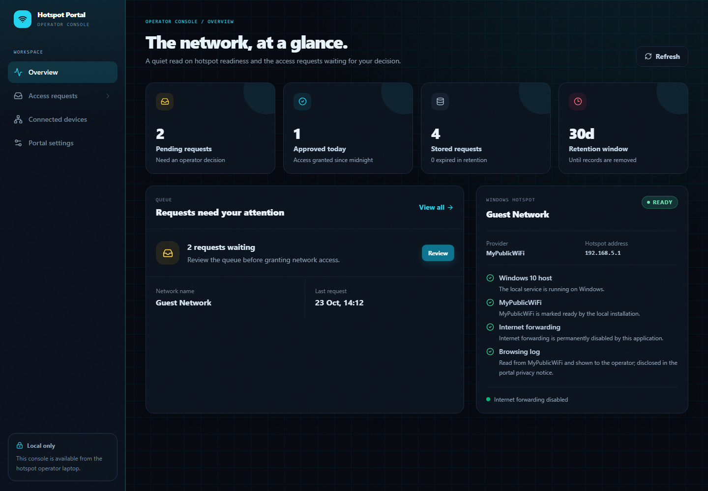
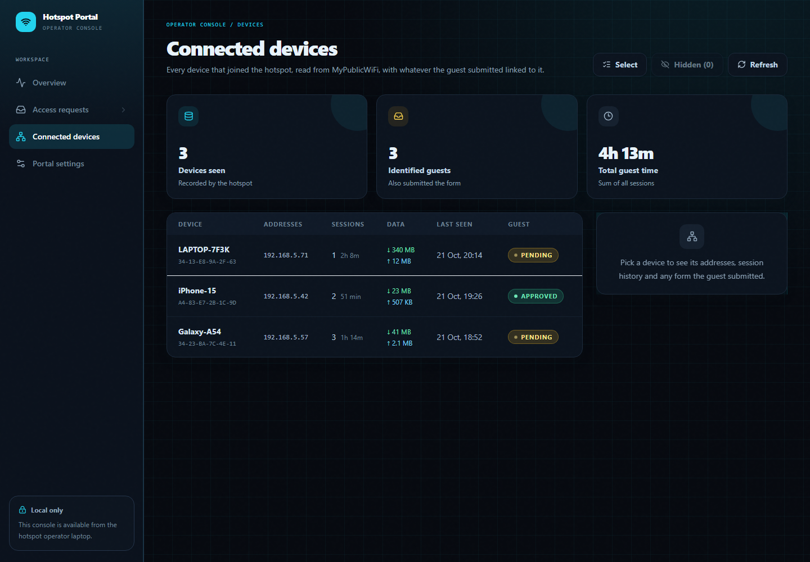
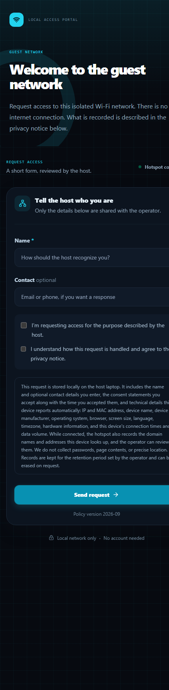

# Windows Hotspot Captive Portal

A self-hosted guest Wi-Fi portal for Windows 10/11. Guests join a local hotspot,
are shown a captive-portal page, and their details are stored on the host laptop
in a local SQLite database. **No internet connection is required** and nothing is
sent to any third-party server.

The Wi-Fi radio, DHCP and the captive redirect are provided by
[MyPublicWiFi](https://mypublicwifi.com/publicwifi/en/index.html) (free). This
project provides the portal page, the operator console and the data store.



## Why this exists

Small venues and one-off events often need a guest Wi-Fi network that does two
things: show visitors a consent notice, and keep a record of who joined. Proper
captive-portal hardware is overkill for that, and a cloud service means shipping
guest data to someone else's server.

A Windows laptop looks like it should be enough. It isn't:

- The built-in **Mobile Hotspot refuses to start** with no internet connection.
- The legacy `netsh wlan set hostednetwork` path needs a driver that reports
  `Hosted network supported: Yes`; most modern Intel adapters report `No`.
- Windows has **no captive portal**. The "sign in to network" prompt only appears
  because a network hijacks DNS and intercepts HTTP — which Windows won't do.

So the project splits the problem: MyPublicWiFi provides the radio, DHCP and the
port-80 intercept; this application provides the portal, the operator console and
the data store — plus the pieces Windows does not give you at all.

## What you get

- **Guest portal** — a consent notice and a short form, served from the host.
- **Operator console** — connected devices, submissions, browsing log, settings.
- **Local storage** — SQLite via Node's built-in `node:sqlite`. No database
  server, no cloud, no accounts.
- **Fully offline** — fonts, icons and styles are bundled locally, so the portal
  renders correctly on a network that has no internet.

## How it works

**Captive DNS.** `artifacts/api-server/src/lib/captive-dns.ts` is a small UDP DNS
server bound to the hotspot address. It answers every A query with that address,
so when a device probes its connectivity endpoint — `connectivitycheck.gstatic.com`
on Android, `captive.apple.com` on Apple, `msftconnecttest.com` on Windows — the
answer points at the portal and the OS concludes it is behind a captive portal.
MyPublicWiFi binds a wildcard `0.0.0.0:53`; binding the specific hotspot IP wins,
so both servers coexist.

**Portal page.** MyPublicWiFi serves its captive page from `Web\`. The installer in
`deploy-mypublicwifi/` backs up the original and writes our redirect page to
`login.html` **and** to every path an OS probe might request: `generate_204`,
`connecttest.txt`, `ncsi.txt`, `hotspot-detect.html`, `success.txt`, `redirect`.
That last one matters — Windows opens `http://www.msftconnecttest.com/redirect`,
which otherwise returns 404 and the browser shows "can't reach this page".

**Two surfaces, one process.** Express 5 serves the guest portal on the hotspot
address (`:8080`) and the operator console bound to `127.0.0.1` only (`:8081`).
The console is a React/Vite bundle served statically; the guest page uses system
fonts and bundled assets, so it renders correctly on a network with no internet.

**Capture on submit.** `artifacts/api-server/src/routes/portal.ts` resolves the
caller's IP to a MAC and hostname from MyPublicWiFi's lease files, parses the user
agent into OS/browser/device class, decodes the manufacturer from an offline OUI
table, and records the device profile the browser reports openly. There is no
fingerprinting — every field is one the browser offers and the portal privacy
notice lists.

**Storage.** One SQLite file in `%LOCALAPPDATA%`, WAL mode, through Node's built-in
`node:sqlite` — no native module to compile. Migrations are additive and run at
startup; expired records are pruned by the configured retention window.

**Operator console.** `artifacts/api-server/src/lib/mypublicwifi.ts` reads
MyPublicWiFi's own database and lease files to group activity per device (sessions,
data used, browsing log) and links guest submissions by the MAC captured at submit
time, so the link survives DHCP lease reuse. Devices are *hidden* rather than
deleted, because the underlying records belong to MyPublicWiFi.

**The trade-off.** The radio/DHCP/intercept layer is not part of this project, so a
MyPublicWiFi update could change the file formats `mypublicwifi.ts` reads. That is
deliberate: writing a kernel-level DHCP, NAT and traffic-accounting stack for
Windows would be a far larger and more fragile project for the same result.

## Requirements

- Windows 10 or 11
- **Node.js 22 or newer** (uses the built-in `node:sqlite`)
- **MyPublicWiFi** — https://mypublicwifi.com/publicwifi/en/index.html (free)
- A Wi-Fi adapter that MyPublicWiFi supports

## Quick start

1. Install Node.js and MyPublicWiFi.
2. Double-click **`2-Install-Captive-Page.cmd`** once. It installs the portal page
   into MyPublicWiFi and keeps a backup of the original file.
3. In MyPublicWiFi: enable **User Authentication**, set your SSID and password,
   then start the hotspot.
4. Double-click **`1-Run-Portal.cmd`**.

| Surface | Address |
| --- | --- |
| Guest portal | `http://192.168.5.1:8080/` |
| Operator console | `http://127.0.0.1:8081/admin` |

Step-by-step detail and troubleshooting live in **[WINDOWS.md](WINDOWS.md)**.

## Project layout

| Path | Purpose |
| --- | --- |
| `artifacts/api-server/` | Express server: guest API, operator API, captive DNS, SQLite |
| `artifacts/local-wifi-portal/` | React + Vite guest page and operator console |
| `lib/api-zod/` | Request and response schemas |
| `lib/api-client-react/` | Typed client used by the console |
| `deploy-mypublicwifi/` | Scripts that install the portal page into MyPublicWiFi |
| `artifacts/api-server/dist/` | Prebuilt server bundle — included in the packaged zip, not in git |

## Building from source

Only needed if you change the code — the shipped bundle already runs.

```powershell
corepack enable
pnpm install
pnpm run build:windows
```

Build on the Windows machine that will run it. A bundle built on another
operating system embeds foreign paths and will not start.

## Packaging for someone else

Run **`5-Make-Zip.cmd`** to produce `Windows-Wi-Fi-Captive-Portal.zip` next to this
folder. It excludes `node_modules`, `.git` and local runtime data, so the result
is small and contains nothing personal.

## Screenshots

**Connected devices** — everyone who joined, with MAC, IPs, session history, data
usage and whatever the guest submitted. Hidden devices are dimmed and can be
restored.



**Guest portal** — the consent notice and access form a guest sees on their phone,
in the same theme.



## Limitations and notes

Worth being explicit about the boundaries of this project:

- **Windows only.** It relies on Windows' hosted network / tethering API.
- **MyPublicWiFi is required.** The radio, DHCP, NAT and the port-80 intercept
  come from that separate product; this project supplies the portal, the
  operator console and the data store. It is not a standalone hotspot.
- **WPA2 only.** Windows cannot broadcast an open network, so a password is
  mandatory (8+ characters). Windows clients may also offer a WPS PIN first;
  "Use password instead" is the correct path.
- **A firewall rule is required** for the portal port, otherwise guests load the
  redirect page and then cannot reach the portal.
- **One client band at a time.** A 2.4 GHz-only phone needs the hotspot pinned to
  2.4 GHz; see [WINDOWS.md](WINDOWS.md) → *Wi-Fi band (2.4 GHz vs 5 GHz)*.
- **No internet by default.** It is built for an isolated network, but MyPublicWiFi
  can share the laptop's connection if you enable it there — the portal and data
  capture are unaffected. See [WINDOWS.md](WINDOWS.md) → *Internet access (optional)*.
- **The browsing log is privacy-sensitive.** It is recorded by MyPublicWiFi and
  must be disclosed to guests in the portal privacy notice.

## Privacy

The portal records what a guest submits (name, contact, consent) plus
device/connection metadata, and can surface MyPublicWiFi's per-device browsing
log. Before using this with real people, publish an accurate privacy notice in
**Portal settings** and make sure guests can have their data erased.

## Credit

Built by **Selim Özdemir** ([@SelimOZD](https://github.com/SelimOZD)).

If you use, deploy, or build on this project, please keep the copyright notice from
[LICENSE](LICENSE) and credit the author with a link back to this repository. Under
the MIT licence, preserving that notice is required; a visible credit beyond it is
requested, but not legally required.

## Third-party software

MyPublicWiFi is a separate product with its own licence and installer; it is not
bundled with this project.
